# Lab 6 — Automating Web Servers with Ansible in AWS

## Overview

Up to now I'd set up every server by hand, one command at a time. That works for one or two machines, but not for the hundreds a real company runs. This lab was my first taste of doing it with automation instead.

I launched three Ubuntu servers in AWS. One is an **Ansible control node**, and the other two are **web servers**. I locked them down with three security groups so the web servers can't be reached over SSH from the internet at all. The only way in is through the control node. I connected to the control node with **SSH agent forwarding**, so my private key never left my laptop, and from there I ran one Ansible playbook. It configured a firewall, installed Apache, and deployed my website on both web servers at the same time.

## Architecture

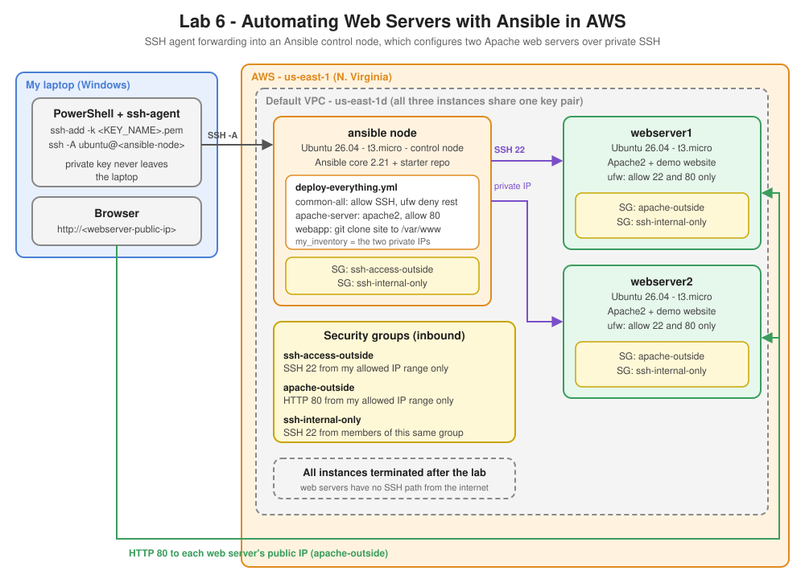

## Objectives

- Design security groups so each server only accepts the traffic it needs
- Use a security group as the source of its own rule, so instances inside it can talk to each other
- Launch three Ubuntu instances in the default VPC with the same key pair
- Use SSH agent forwarding to hop from my laptop to a private server without copying my key
- Install Ansible and run an ad-hoc command and a playbook against an inventory of servers

## Tools & Technologies

| Category | Tools |
|---|---|
| Cloud | AWS EC2, default VPC, security groups (`us-east-1`) |
| OS | Ubuntu Server 26.04 LTS, `t3.micro` |
| Automation | Ansible core 2.21 (inventory, ad-hoc `ping` module, playbook with roles) |
| SSH | OpenSSH, `ssh-agent`, `ssh-add`, agent forwarding (`ssh -A`) |
| Services | Apache2, ufw, Git |
| Client | PowerShell on Windows |

## The Plan

| Server | Security groups | What it does |
|---|---|---|
| ansible node | `ssh-access-outside`, `ssh-internal-only` | The only server I SSH into from outside. Holds the playbooks. |
| webserver1 | `apache-outside`, `ssh-internal-only` | Serves the website. SSH only from inside the group. |
| webserver2 | `apache-outside`, `ssh-internal-only` | Same as webserver1. |

---

## Task 1 — Security Groups

All three groups are in the default VPC. For the two "outside" groups I limited the source to the IP range of a VPN I connect through, instead of opening them to the whole internet.

| Group | Inbound rule |
|---|---|
| `ssh-access-outside` | SSH (TCP 22) from my VPN's address range only |
| `apache-outside` | HTTP (TCP 80) from my VPN's address range only |
| `ssh-internal-only` | SSH (TCP 22) from **`ssh-internal-only` itself** |

### apache-outside

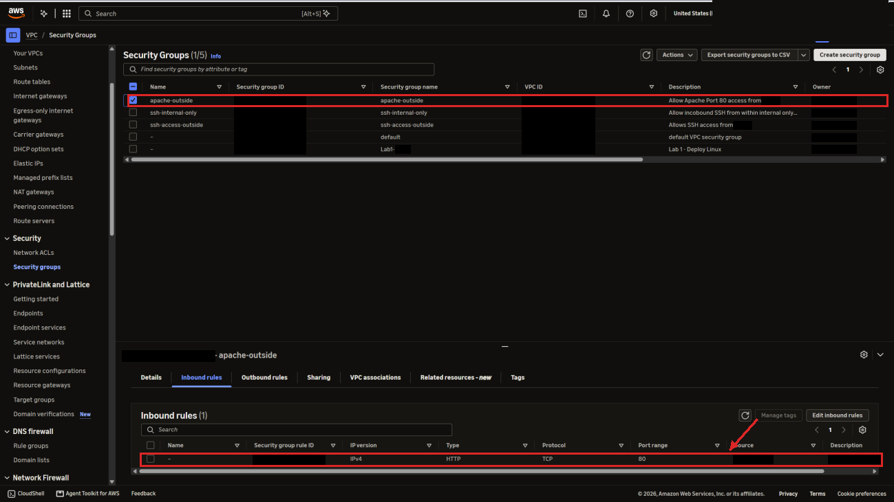

### ssh-access-outside

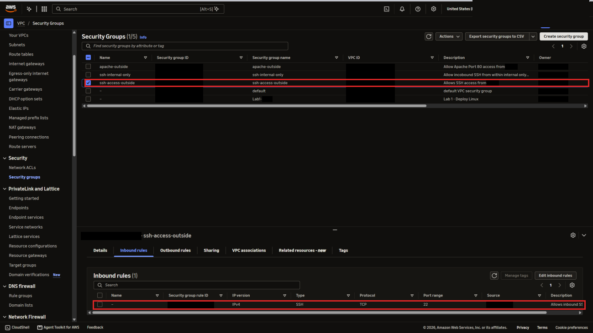

### ssh-internal-only

This one is the interesting rule. Its source isn't an IP range. It's the security group's own ID. I created the group with no rules, copied its ID, then edited it to allow SSH from that ID. That means: **any instance in this group can SSH to any other instance in this group**, and nothing outside it can. Because all three servers are in it, the control node can reach both web servers over SSH, but the internet can't.


---

## Task 2 — Launch the Three Servers

I launched three Ubuntu instances from the Quick Start AMI, all with the same key pair, named them in the EC2 console, and attached the groups from the plan above. Each screenshot shows the instance's security groups and the combined inbound rules they produce.

### ansible node

SSH from the VPN range (`ssh-access-outside`) plus SSH from inside the group (`ssh-internal-only`).

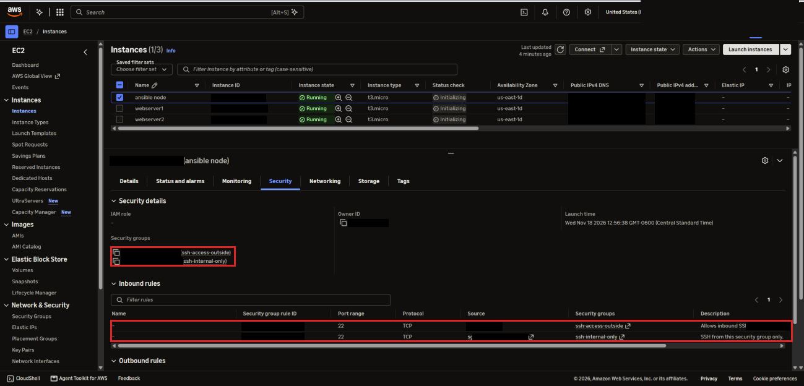

### webserver1

HTTP from the VPN range (`apache-outside`) plus SSH from inside the group. There's **no** rule that allows SSH from the internet.

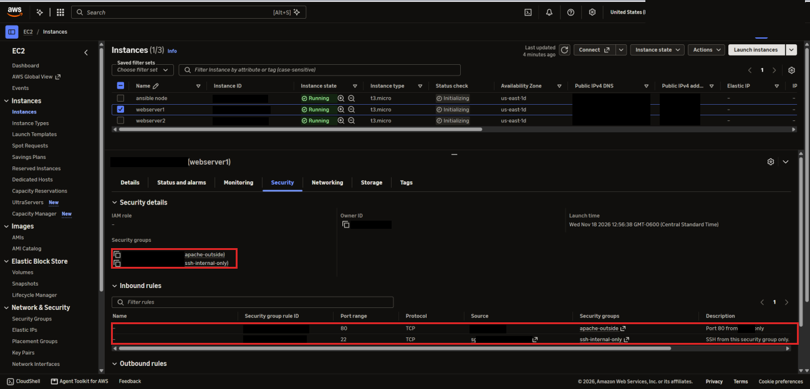

### webserver2


---

## Task 3 — SSH Agent Forwarding and Installing Ansible

### 3.1 Start ssh-agent on Windows

Agent forwarding needs `ssh-agent` running locally. On Windows the service was stopped, so I started it from an admin PowerShell:

```powershell
Get-Service -Name ssh-agent                     # Status: Stopped
Set-Service -Name ssh-agent -StartupType Manual
Start-Service ssh-agent
Get-Service -Name ssh-agent                     # Status: Running
```

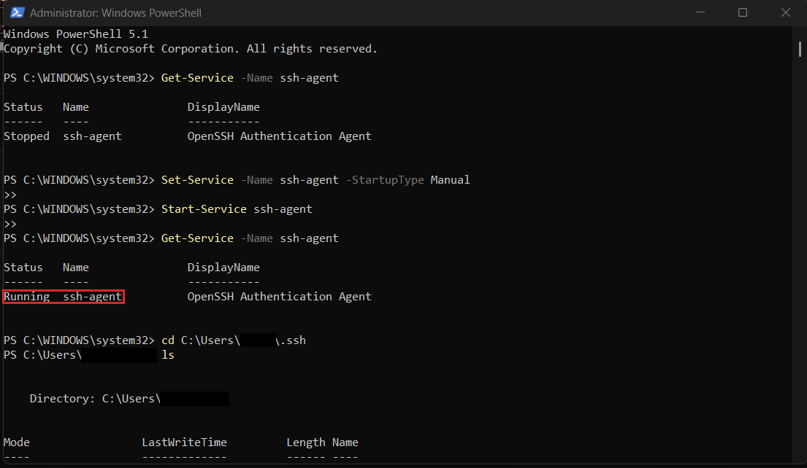

### 3.2 Load my key into the agent

```powershell
ssh-add -k .\<KEY_NAME>.pem      # hand the private key to the agent
ssh-add -L                        # confirm the agent is holding it
```

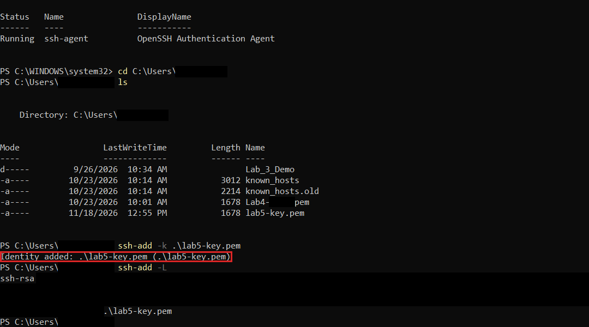

### 3.3 Connect to the control node with forwarding

```powershell
ssh -A ubuntu@<ansible-node-public-dns>
```

`-A` turns on agent forwarding. When I SSH from the control node to another server, that server's login challenge gets passed back through the connection to the agent on my laptop. The laptop answers it, so the control node never gets a copy of my private key.

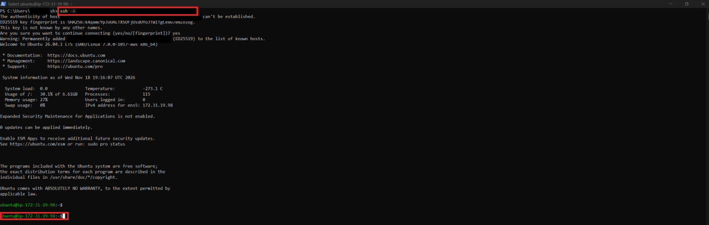

### 3.4 Hop to each web server

From the control node I SSH'd to each web server's **private** IP. It worked without a key file on the control node, because of the forwarded agent, and it was allowed by `ssh-internal-only`.

```bash
ssh ubuntu@<webserver1-private-ip>
logout
ssh ubuntu@<webserver2-private-ip>
logout
```

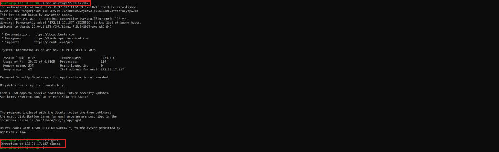

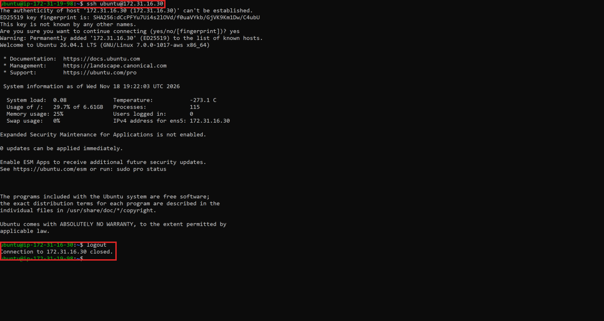

### 3.5 Install Ansible and clone the starter repo

I installed Ansible on the control node only. Ansible is **agentless**, so the web servers don't need anything installed except SSH and Python, which Ubuntu already has. Then I cloned a starter Ansible repo into the `ubuntu` user's home folder. It contains the playbook, an inventory file, and three roles.

```bash
ansible --version       # ansible [core 2.21.5]
git clone <starter-repo-url>
cd <starter-repo>
ls -la                  # README.md  deploy-everything.yml  my_inventory  roles/
```

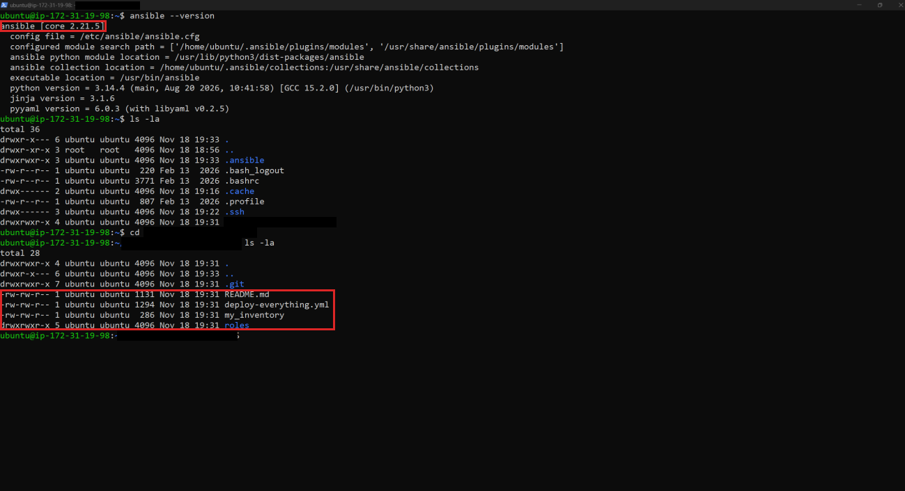

---

## Task 4 — Configure Both Servers with Ansible

### 4.1 Point Ansible at my servers

**`my_inventory`** lists the hosts to manage. I added both web servers' private IPs under the `[webservers]` group:

```ini
[webservers]
<webserver1-private-ip>
<webserver2-private-ip>
```

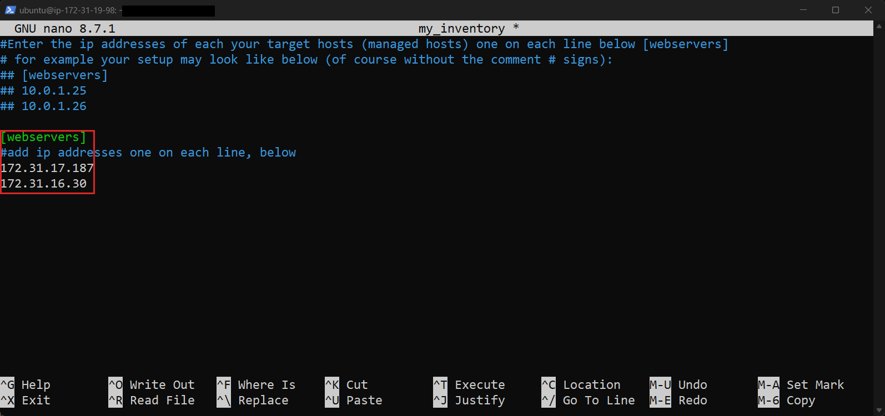

**`roles/webapp/defaults/main.yml`** holds the Git repo the `webapp` role deploys. I set it to the demo website I built and pushed to GitHub in [Lab 2](../lab-02-deploy-services-and-workflow/):

```yaml
repository: https://github.com/willkhot/<demo-site-repo>.git
```

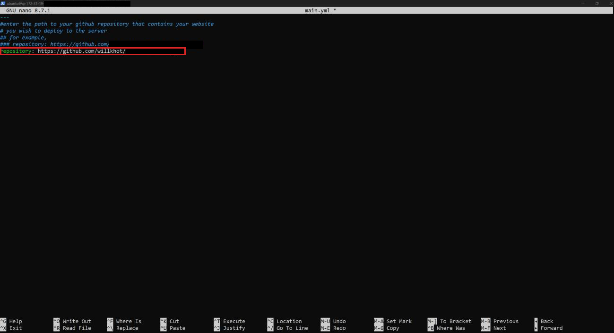

### 4.2 Test the connection with an ad-hoc command

```bash
ansible -i my_inventory -m ping all
```

The `ping` module doesn't send an ICMP ping. It logs in over SSH and checks that Python works. Both servers answered `SUCCESS` with `"ping": "pong"`. The yellow warnings just mean Ansible picked the server's Python version automatically.

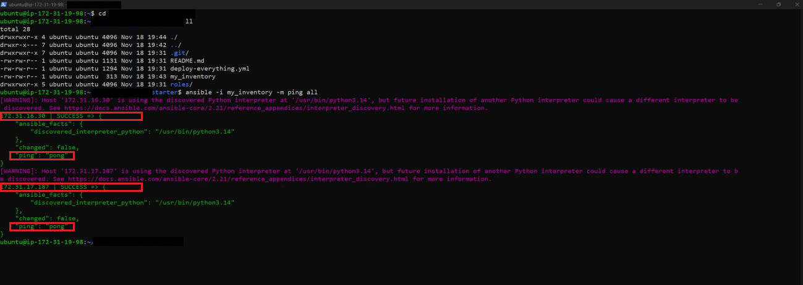

### 4.3 Run the playbook

```bash
ansible-playbook deploy-everything.yml -i my_inventory
```

The playbook ran three roles on both servers at the same time:

| Role | Tasks |
|---|---|
| `common-all` | Allow the SSH port in ufw, then enable ufw with default deny for everything else |
| `apache-server` | Install `apache2`, allow HTTP (port 80) in ufw |
| `webapp` | Install Git, clone my site repo, copy the site files (minus `.git` and the README) into Apache's web folder |

The recap showed **`ok=8 changed=6 failed=0`** on both hosts. One command configured two servers identically, and I'd get the same result for 200.

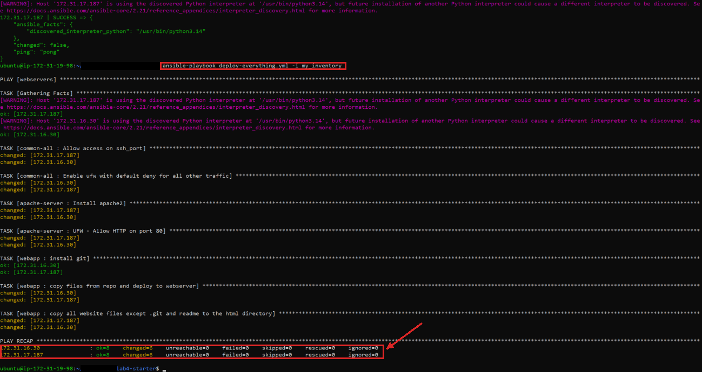

Each server ended up with two layers of firewall: the AWS security groups at the network edge and ufw on the host itself.

### 4.4 Check the website

I opened `http://<webserver-public-ip>` for each server (plain HTTP, since only port 80 is open), and both served my site.

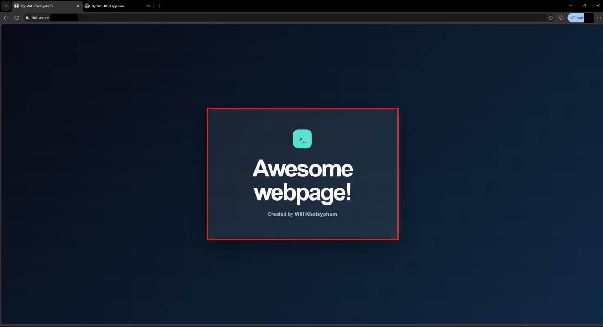


---

## What I Learned

- Doing things by hand doesn't scale. Ansible let me describe the end state once and apply it to every server in the inventory.
- Ansible is agentless. It only needs SSH and Python on the targets, and it's built so running a playbook twice doesn't redo work that's already done.
- A security group can use itself as a source. That's a clean way to say "these servers can talk to each other, nothing else can."
- Keeping SSH off the web servers' public side and going through one control node shrinks the attack surface a lot
- SSH agent forwarding lets me hop between servers while my private key stays on my laptop. The tradeoff is that I should only forward to servers I trust, because someone with root on that server could use my agent while I'm connected.
- Defense in depth: security groups at the AWS level and ufw on each host both have to allow traffic before it gets through

---

> **Note:** Screenshots are from a temporary AWS lab account. The account ID, lab session username, owner ID, instance, security group, VPC and rule IDs, public IPs and DNS names, the allowed source IP range, my local username, and my public key have been redacted, along with course-specific names. The private `172.31.x.x` addresses are internal to the VPC. All instances were terminated after the lab.
